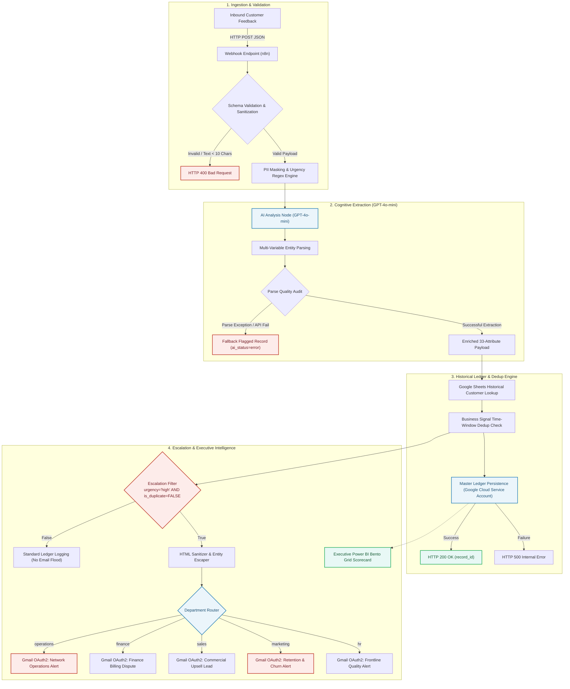
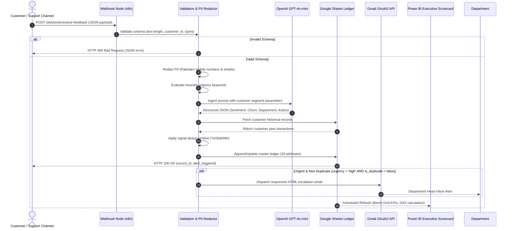

# Technical Architecture & Systems Engineering
## Orbitel Automated Customer Sentiment & Churn Risk Intelligence Engine

This document provides the exhaustive architectural specification, data schemas, security mechanisms, and failover topologies for the **Orbitel Customer Sentiment & Churn Risk Intelligence Engine**.

---

## 1. End-to-End System Architecture

The engine implements an asynchronous, event-driven, cognitive automation pipeline that transforms unstructured customer feedback into real-time operational escalations and C-Suite executive intelligence.



---

## 2. Pipeline Sequence & Temporal Interaction



---

## 3. Data Dictionary: The 33 Discrete Ledger Attributes

The master data model (`'Sheet1'`) persists 33 standardized attributes for every interaction:

| # | Attribute Name | Data Type | Permitted Values / Constraints | Business Description |
|---|---|---|---|---|
| 1 | `customer_id` | String | Max 100 chars, Non-empty | Unique Orbitel subscriber or corporate account ID |
| 2 | `sentiment` | String | `positive`, `negative`, `neutral` | Primary emotional polarity classified by GPT-4o-mini |
| 3 | `confidence_score` | Float | `0.00` to `1.00` (Clamped) | Model classification confidence certainty score |
| 4 | `issue_categories` | String | `network`, `billing`, `pricing`, `coverage`, `customer_service`, `roaming`, `service_delay` | Comma-separated multi-label categorization |
| 5 | `urgency` | String | `high`, `medium`, `low` | Action priority (Overridden to `high` by regex heuristics) |
| 6 | `churn_risk` | Boolean | `TRUE`, `FALSE` | Explicit indication of customer intent to disconnect/switch |
| 7 | `root_cause_summary` | String | Max 1000 chars | 1-2 sentence analytical diagnosis of core breakdown |
| 8 | `recommended_action` | String | Max 1000 chars | Department-specific remedial protocol instructions |
| 9 | `source` | String | Max 100 chars | Ingestion channel (e.g., WhatsApp, App, Web, Call Center) |
| 10 | `timestamp` | ISO-8601 | YYYY-MM-DDTHH:mm:ss.sssZ | UTC timestamp of customer interaction |
| 11 | `record_id` | String | `rec-{timestamp}-{uuid}` | Globally unique idempotent ledger primary key |
| 12 | `business_signal` | String | `coverage_expansion`, `billing_issue`, `upsell_opportunity`, `service_recovery`, `hr_escalation`, `product_feedback`, `none` | Cross-functional strategic indicator |
| 13 | `location_mentioned` | String | City / Area Name or `""` | Geographic entity extracted from unstructured feedback |
| 14 | `target_department` | String | `operations`, `finance`, `sales`, `marketing`, `hr` | Responsible department head routing destination |
| 15 | `retention_offer_type` | String | `discount`, `bonus_data`, `free_month`, `plan_upgrade`, `service_credit`, `none` | Tailored commercial incentive for churn containment |
| 16 | `retention_priority` | String | `immediate`, `within_24h`, `within_week`, `no_action` | Operational SLA for retention desk outreach |
| 17 | `retention_message` | String | Max 1000 chars | AI pre-drafted outbound SMS / WhatsApp message |
| 18 | `Customer_type` | String | `individual`, `household`, `sme`, `corporate`, `enterprise` | Core account tier categorization |
| 19 | `service_type` | String | `broadband`, `fiber`, `postpaid`, `prepaid`, `roaming`, `business_plan` | Telecommunications service architecture |
| 20 | `parse_error` | Boolean | `TRUE`, `FALSE` | Telemetry integrity flag indicating LLM format failure |
| 21 | `matched_urgency_labels` | String | Comma-separated labels | Regex rule triggers (`outage`, `sue`, `switch`, `MNP`, etc.) |
| 22 | `is_duplicate` | Boolean | `TRUE`, `FALSE` | Anti-flood suppress indicator |
| 23 | `duplicate_of` | String | `record_id` of parent record | Reference pointer to original open issue within window |
| 24 | `dedup_window_hours` | Integer | `24`, `48`, `168`, `720`, `2160` | Signal-specific lookback window duration in hours |
| 25 | `customer_segment_impact` | String | Max 500 chars | Contextual assessment of revenue impact vs churn risk |
| 26 | `product_used` | String | `postpaid_plan`, `data_bundle`, `roaming`, `broadband`, `business_plan` | Exact tariff product associated with complaint |
| 27 | `plan_type` | String | `basic`, `standard`, `premium`, `business`, `unknown` | Contract tier of subscriber |
| 28 | `customer_value_segment` | String | `low`, `medium`, `high`, `premium`, `unknown` | High-level ARPU monetization segment |
| 29 | `usage_behavior` | String | `high_data_user`, `low_usage_user`, `roaming_user`, `business_critical_user`, `price_sensitive_user` | Telemetry consumption behavior pattern |
| 30 | `business_individual_segment`| String | `individual`, `business`, `unknown` | Enterprise B2B vs Consumer B2C categorization |
| 31 | `tenure_segment` | String | `new_customer`, `existing_customer`, `long_term_customer` | Account lifetime longevity index |
| 32 | `ai_status` | String | `ok`, `failed`, `parse_error` | System diagnostic health status for the cognitive agent |
| 33 | `status` | String | `ok`, `error` | Holistic end-to-end processing pipeline execution status |

---

## 4. Security, Compliance & Data Privacy Architecture

### A. Client-Side PII Masking (Zero Data Leakage)
Before any text payload is transmitted to the external OpenAI API endpoint, Node 2 executes local deterministic regex sanitation.
- **Email Redaction:** All strings matching RFC 5322 compliance are replaced with `[EMAIL_REMOVED]`.
- **Pakistani Telecom Numbers:** Full regex coverage for Pakistani formats (`+92 3XX XXXXXXX`, `03XX-XXXXXXX`, `923XXXXXXXXX`) replacing numbers with `[PHONE_REMOVED]`.
- **GDPR / PECA Compliance:** Guarantees that neither customer names, contact credentials, nor sensitive identity artifacts are stored in external model caches or training weights.

### B. Enterprise Authentication & Secrets Management
- **Google Cloud Service Account:** Node 7 and 8 authenticate to the enterprise Google Sheets master ledger utilizing an asymmetric RSA private key stored in n8n encrypted environment vaults (`GOOGLE_SERVICE_ACCOUNT_CREDENTIAL_ID`). Scopes are constrained strictly to `https://www.googleapis.com/auth/spreadsheets`.
- **Gmail OAuth2:** Outbound department email dispatchers (Nodes 12a–12e) utilize OAuth2 refresh token grants with scoped mail transmission privileges, eliminating hardcoded SMTP credentials.
- **HTML Injection Defense:** Node 10a executes full character entity replacement (`&`, `<`, `>`, `"`, `'`) on all variables interpolated into outgoing alert emails, neutralizing stored XSS or email rendering vulnerabilities.

---

## 5. Deduplication & Anti-Flood Shield

To prevent department heads from being flooded by repetitive alerts when a customer vents multiple times across channels (e.g., WhatsApp, followed by Call Center, followed by Email), Node 9 implements dynamic **Signal-Specific Window Deduplication**:

```
+---------------------------+-------------------+---------------------------------------------+
| Business Signal           | Dedup Window      | Operational Justification                   |
+---------------------------+-------------------+---------------------------------------------+
| coverage_expansion        | 7 Days (168h)     | Tower RF audits require 5-7 business days    |
| billing_issue             | 30 Days (720h)    | Covers entire monthly invoice cycle         |
| service_recovery          | 48 Hours (48h)    | Rapid technical triage window               |
| hr_escalation             | 7 Days (168h)     | Internal QA & conduct review turnaround     |
| upsell_opportunity        | 30 Days (720h)    | Prevents nagging leads across sales reps    |
| product_feedback          | 90 Days (2160h)   | Quarterly strategic feedback evaluation     |
| default / none            | 24 Hours (24h)    | Standard daily buffer                       |
+---------------------------+-------------------+---------------------------------------------+
```

**Execution Behavior:**
1. Node 8 pulls historical rows matching `customer_id`.
2. Node 9 checks if an unsuppressed record with the same `business_signal` was processed within the lookback window.
3. If duplicate is detected:
   - Record is stored in master ledger with `is_duplicate = TRUE` and `duplicate_of = parent_record_id`.
   - Node 10 intercepts execution and **suppresses email dispatch**.
   - Customer receives standard HTTP 200 acknowledgment without generating operational noise.

---

## 6. Resilience, Retries & Fallback Strategy

1. **LLM Transient Failure Tolerance:**
   - OpenAI API node configured with 3 automatic retries and 4,000ms exponential backoff.
   - If OpenAI endpoint times out or errors, Node 3 executes `onError: continueRegularOutput`.
2. **Deterministic Fallback Parsing (Node 4):**
   - The JSON extractor utilizes a recursive brace-counting tokenizer that isolates valid `{...}` blocks even if the LLM emits surrounding conversational prose.
   - If AI analysis completely fails (`ai_status = failed`), the engine **never crashes**:
     - It logs the original text with `status = error` and `ai_status = parse_error`.
     - It defaults `urgency = "high"` and assigns `target_department = "operations"` to ensure a human supervisor reviews the unparsed telemetry.
3. **Database Write Protection:**
   - Google Sheets logging node (Node 7) implements 3 retries with 2,000ms intervals.
   - If Google Cloud fails, Node 7c dispatches HTTP 500 error payload with `record_id` for automated dead-letter replay.

